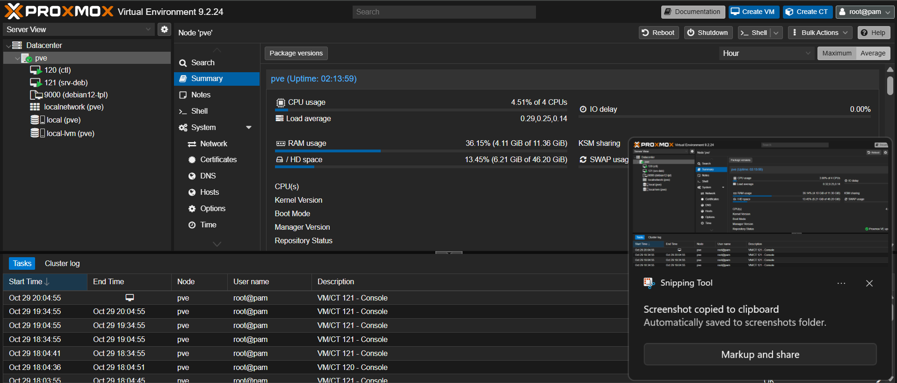
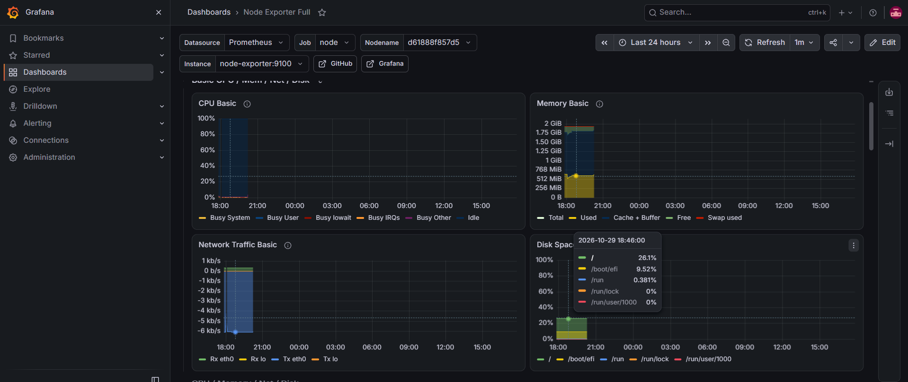
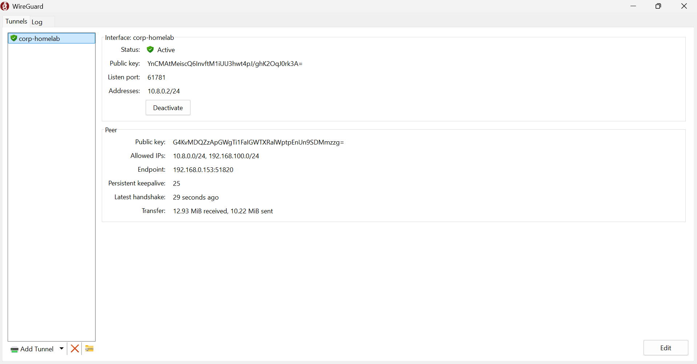

# Virtual Homelab

A small virtual lab I built to practice the basics of Proxmox and Ansible. Everything runs on one Windows PC: Proxmox VE sits inside VMware Workstation (nested virtualization) and hosts two Debian VMs.

## Layout

```
Windows PC
└── VMware Workstation (NAT, 192.168.100.0/24)
    └── Proxmox VE                192.168.100.10
        ├── ctl      (Debian 12)  192.168.100.20   Ansible control node
        └── srv-deb  (Debian 12)  192.168.100.21   Docker host + WireGuard server
```

## What's in it

- **Proxmox VE (KVM):** a cloud-init Debian template, and both VMs are clones of it
- **Ansible:** three roles run from `ctl`
  - `ssh_hardening`: key-only login, no root, limited auth attempts
  - `docker`: installs Docker Engine and the compose plugin from the official repo
  - `monitoring`: deploys the monitoring stack below
- **Docker Compose:** Prometheus, node_exporter and Grafana, with the Prometheus datasource provisioned automatically
- **Grafana:** Node Exporter Full dashboard (CPU, RAM, disk, network)
- **WireGuard:** tunnel from my laptop into the lab network
- **Git:** all the code lives in this repo

## Usage

From the `ctl` VM:

```bash
git clone https://github.com/wendtcloud/homelab-ansible.git
cd homelab-ansible
ansible all -m ping
ansible-playbook site.yml
```

After the run:

- Grafana: http://192.168.100.21:3000
- Prometheus: http://192.168.100.21:9090

The playbook is idempotent, so a second run should report `changed=0`.

## Repo structure

```
.
├── ansible.cfg
├── inventory.ini
├── site.yml
└── roles/
    ├── ssh_hardening/
    ├── docker/
    └── monitoring/
```

## Screenshots





## Notes

- Proxmox runs nested inside VMware Workstation, so this is a learning setup and not meant for real workloads.
- Credentials and WireGuard keys are not stored in the repo. Change the default Grafana password after the first login.
- Things I'd add next: a firewall role, Ansible Vault for secrets, and alerting in Grafana.
